# Does your imputer preserve your model's explanation?

**Assessing imputation for survival ML via interpretability distortion**

Imad El Badisy1, Roch Giorgi2

1 AI & Data Science Service, Mohammed VI Center for Research and Innovation (CM6RI), Rabat, Morocco 
2 Aix-Marseille Univ, INSERM, IRD, SESSTIM, ISSPAM, Marseille, France

Poster at **ISCB-GMDS 2026**, Freiburg (27 Sep to 1 Oct 2026), display **28-P2-12**.

This repository holds the **full results** behind the poster: every figure and table from the simulation study and the four-cohort real-data application. The analysis code will be released together with the paper.

Contact: [ielbadisy@cm6.ma](mailto:ielbadisy@cm6.ma)

---

## Contents

- [Take-home](#take-home)
- [Study design](#study-design)
- [Simulation results](#simulation-results)
- [Real-data application](#real-data-application)
- [Files](#files)

## Take-home

Imputers with similar predictive accuracy can distort survival-model explanations (PDP, SHAP, calibration) differently. Interpretability summaries can be treated as **estimands**, and **distortion** is the error an imputer introduces for them.

- **Complete-case analysis was worst overall:** worst mean rank in simulation (5.33/6) and in the pooled cohorts (4.38/6).
- **xgboost** had the best mean rank in simulation (1.90; knn second, 3.12); in the pooled cohorts xgboost, rpart, svm and knn were close (3.08 to 3.33).
- The best ML imputer **varies by cohort**: audit imputation through interpretability on your own data, alongside accuracy.

## Study design

| | Simulation | Real-data application |
|---|---|---|
| Data | Synthetic right-censored survival data, n = 300 per replicate | 4 survival cohorts (below) |
| Missingness | `x1_cont` amputated, 30% MAR | 3 covariates per cohort jointly amputated, about 40% MAR |
| Replicates | 100 Monte Carlo replicates | Single amputation draw (illustrative) |
| Imputation | Multiple imputation, M = 5 | Multiple imputation, M = 3 (single imputation also reported) |
| Learners | Cox PH, random survival forest (RSF), deep survival network (SurvDNN) | Same three learners; RSF shown in main tables |
| Imputers | complete-case, knn, xgboost, rf, svm, rpart | Same six |

**Distortion metrics** (all compare the imputed-data output with the complete-data reference; lower is better):

| Metric | What it measures |
|---|---|
| BriernRMSE | Normalized RMSE between Brier score curves |
| CalibnRMSE | Normalized RMSE between calibration summaries |
| PDPnRMSE | Normalized RMSE between partial dependence curves |
| SHAPL1 | Total-variation (L1) distance between SHAP importance profiles |
| SHAPrank | Rank distortion of SHAP importance |
| VarImpL1 | Total-variation (L1) distance between permutation importance profiles |
| VarImprank | Rank distortion of permutation importance |

Survival-scale summaries (PDP, calibration) are pooled across imputations on the complementary log-log scale before distortion is computed.

## Simulation results

### Overview (poster heatmap)

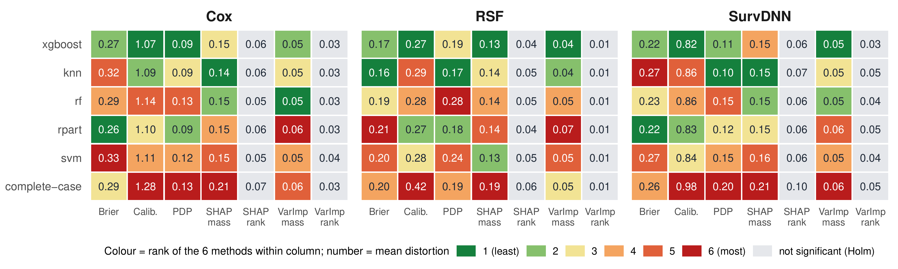

Mean distortion under MI (printed); cell colour = rank among the 6 methods within each learner by metric (green = least, red = most distortion); grey = Friedman test not significant after Holm correction over the 21 learner by metric tests. Equal distortion was rejected in **19/21** combinations (unadjusted p < 0.05) and **15/21** after Holm correction: every magnitude metric stays significant; only the rank metrics do not.

### Mean ± SD tables (100 replicates)

Best value per column in bold.

#### Cox proportional hazards

| Method | BriernRMSE | CalibnRMSE | PDPnRMSE | SHAPL1 | SHAPrank | VarImpL1 | VarImprank |
|---|:---:|:---:|:---:|:---:|:---:|:---:|:---:|
| complete-case | 0.288 ± 0.119 | 1.275 ± 0.272 | 0.133 ± 0.057 | 0.211 ± 0.105 | 0.074 ± 0.067 | 0.057 ± 0.032 | 0.032 ± 0.048 |
| knn | 0.321 ± 0.134 | 1.088 ± 0.238 | 0.093 ± 0.044 | **0.144 ± 0.079** | 0.056 ± 0.064 | 0.049 ± 0.033 | 0.032 ± 0.045 |
| xgboost | 0.274 ± 0.121 | **1.069 ± 0.233** | **0.088 ± 0.043** | 0.152 ± 0.076 | 0.056 ± 0.060 | 0.047 ± 0.037 | 0.029 ± 0.042 |
| rf | 0.293 ± 0.142 | 1.144 ± 0.247 | 0.130 ± 0.049 | 0.152 ± 0.077 | **0.052 ± 0.060** | **0.047 ± 0.029** | **0.028 ± 0.042** |
| svm | 0.325 ± 0.160 | 1.113 ± 0.228 | 0.124 ± 0.056 | 0.154 ± 0.080 | 0.054 ± 0.058 | 0.052 ± 0.030 | 0.040 ± 0.053 |
| rpart | **0.263 ± 0.117** | 1.102 ± 0.242 | 0.092 ± 0.052 | 0.152 ± 0.081 | 0.058 ± 0.057 | 0.057 ± 0.040 | 0.032 ± 0.048 |

#### Random survival forest (RSF)

| Method | BriernRMSE | CalibnRMSE | PDPnRMSE | SHAPL1 | SHAPrank | VarImpL1 | VarImprank |
|---|:---:|:---:|:---:|:---:|:---:|:---:|:---:|
| complete-case | 0.195 ± 0.079 | 0.421 ± 0.155 | 0.193 ± 0.060 | 0.190 ± 0.104 | 0.059 ± 0.062 | 0.050 ± 0.027 | 0.015 ± 0.023 |
| knn | **0.160 ± 0.075** | 0.286 ± 0.113 | **0.169 ± 0.042** | 0.137 ± 0.069 | 0.049 ± 0.051 | 0.041 ± 0.025 | 0.010 ± 0.024 |
| xgboost | 0.170 ± 0.074 | **0.268 ± 0.096** | 0.189 ± 0.053 | **0.128 ± 0.065** | 0.044 ± 0.045 | **0.041 ± 0.024** | **0.010 ± 0.020** |
| rf | 0.189 ± 0.079 | 0.281 ± 0.117 | 0.283 ± 0.071 | 0.140 ± 0.070 | 0.046 ± 0.049 | 0.052 ± 0.027 | 0.013 ± 0.022 |
| svm | 0.203 ± 0.092 | 0.279 ± 0.118 | 0.236 ± 0.067 | 0.133 ± 0.071 | 0.045 ± 0.047 | 0.054 ± 0.032 | 0.012 ± 0.021 |
| rpart | 0.212 ± 0.095 | 0.275 ± 0.104 | 0.179 ± 0.053 | 0.144 ± 0.074 | **0.042 ± 0.047** | 0.075 ± 0.038 | 0.011 ± 0.021 |

#### SurvDNN

| Method | BriernRMSE | CalibnRMSE | PDPnRMSE | SHAPL1 | SHAPrank | VarImpL1 | VarImprank |
|---|:---:|:---:|:---:|:---:|:---:|:---:|:---:|
| complete-case | 0.260 ± 0.109 | 0.983 ± 0.221 | 0.204 ± 0.097 | 0.213 ± 0.098 | 0.096 ± 0.086 | 0.061 ± 0.031 | 0.053 ± 0.061 |
| knn | 0.271 ± 0.106 | 0.865 ± 0.200 | **0.105 ± 0.043** | **0.146 ± 0.076** | 0.069 ± 0.074 | 0.052 ± 0.028 | 0.050 ± 0.058 |
| xgboost | 0.219 ± 0.085 | **0.817 ± 0.175** | 0.111 ± 0.052 | 0.153 ± 0.074 | 0.064 ± 0.064 | **0.048 ± 0.028** | **0.032 ± 0.044** |
| rf | 0.229 ± 0.113 | 0.855 ± 0.191 | 0.155 ± 0.052 | 0.150 ± 0.073 | 0.062 ± 0.081 | 0.050 ± 0.025 | 0.039 ± 0.055 |
| svm | 0.270 ± 0.130 | 0.843 ± 0.199 | 0.147 ± 0.057 | 0.156 ± 0.078 | **0.061 ± 0.058** | 0.054 ± 0.028 | 0.042 ± 0.054 |
| rpart | **0.218 ± 0.092** | 0.834 ± 0.180 | 0.121 ± 0.052 | 0.151 ± 0.079 | 0.064 ± 0.059 | 0.056 ± 0.032 | 0.046 ± 0.058 |

### Inferential comparison

For each learner by metric combination, a Friedman test (paired by replicate, n = 100) tests equality of distortion across the six imputers. Post-hoc paired Wilcoxon signed-rank tests (Holm-adjusted) compare the best imputer with each of the other five.

| Learner | Metric | Friedman *p* | Best imputer | Sig. vs. best (Holm) |
|---|---|:---:|:---:|:---:|
| Cox | BriernRMSE | <0.001 | rpart | 3/5 |
| Cox | CalibnRMSE | <0.001 | xgboost | 2/5 |
| Cox | PDPnRMSE | <0.001 | xgboost | 3/5 |
| Cox | SHAPL1 | <0.001 | knn | 4/5 |
| Cox | SHAPrank | 0.010 | rf | 1/5 |
| Cox | VarImpL1 | 0.003 | rf | 2/5 |
| Cox | VarImprank | 0.377 | rf | 0/5 |
| RSF | BriernRMSE | <0.001 | knn | 4/5 |
| RSF | CalibnRMSE | <0.001 | xgboost | 1/5 |
| RSF | PDPnRMSE | <0.001 | knn | 4/5 |
| RSF | SHAPL1 | <0.001 | xgboost | 3/5 |
| RSF | SHAPrank | 0.029 | rpart | 1/5 |
| RSF | VarImpL1 | <0.001 | xgboost | 4/5 |
| RSF | VarImprank | 0.774 | knn | 0/5 |
| SurvDNN | BriernRMSE | <0.001 | rpart | 3/5 |
| SurvDNN | CalibnRMSE | <0.001 | xgboost | 2/5 |
| SurvDNN | PDPnRMSE | <0.001 | knn | 3/5 |
| SurvDNN | SHAPL1 | <0.001 | knn | 1/5 |
| SurvDNN | SHAPrank | 0.010 | svm | 1/5 |
| SurvDNN | VarImpL1 | 0.005 | xgboost | 1/5 |
| SurvDNN | VarImprank | 0.032 | xgboost | 2/5 |

The per-cell means, SDs and Monte Carlo standard errors are in [`summaries/simulation-summary.csv`](summaries/simulation-summary.csv), and the Friedman p-values (raw and Holm-adjusted over 21 tests) in [`summaries/simulation-friedman.csv`](summaries/simulation-friedman.csv).

### Distribution figures

**Figure 1.** Distribution of all seven distortion metrics across replicates, by learner and imputer (MI).

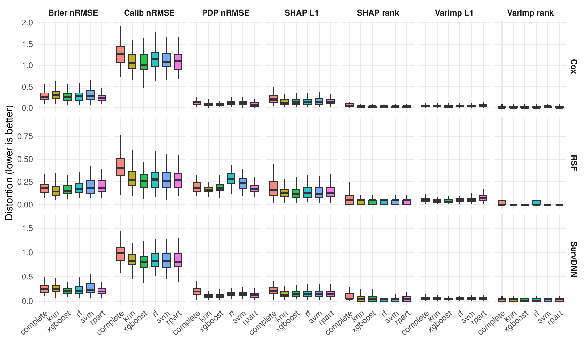

**Figure 2.** Permutation variable importance (C-index delta) per covariate, by learner and imputer (MI).

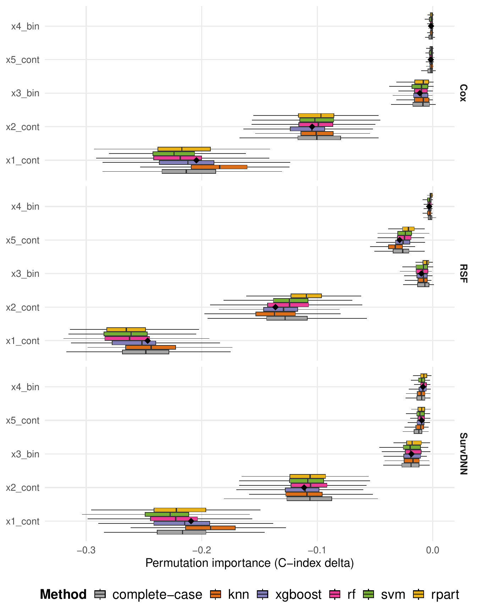

**Figure 3.** SHAP importance per covariate, by learner and imputer (MI).

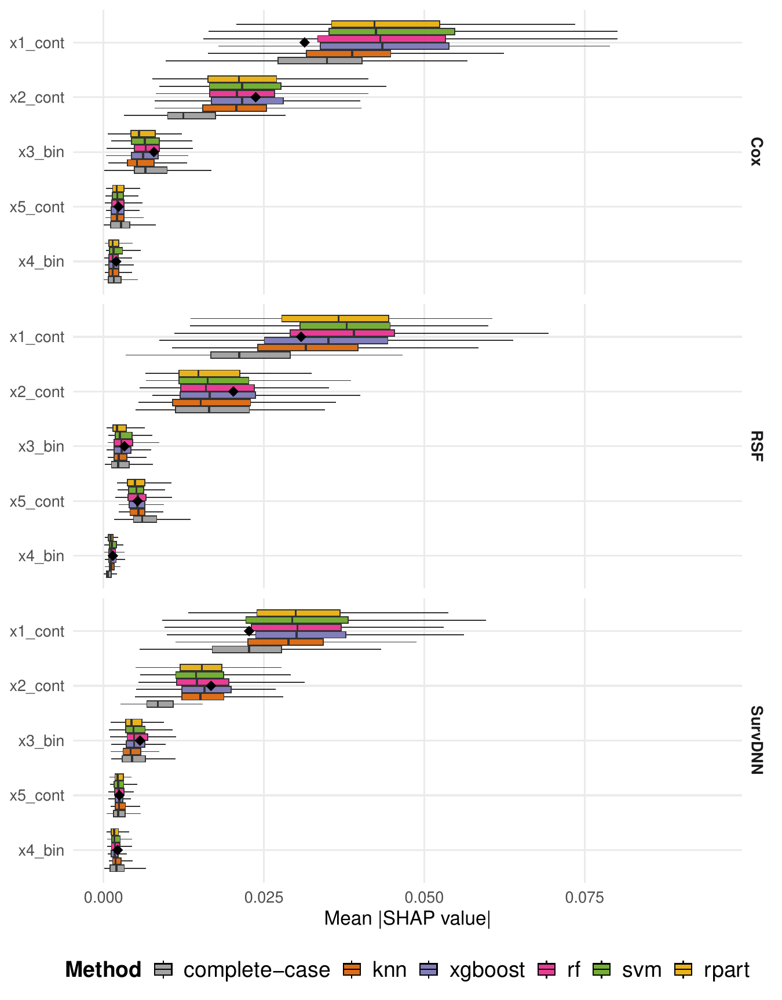

**Figure 4.** Partial dependence of integrated survival on the amputated covariate x1, per replicate (grey) and on average, against the complete-data reference (black dashed) (MI).

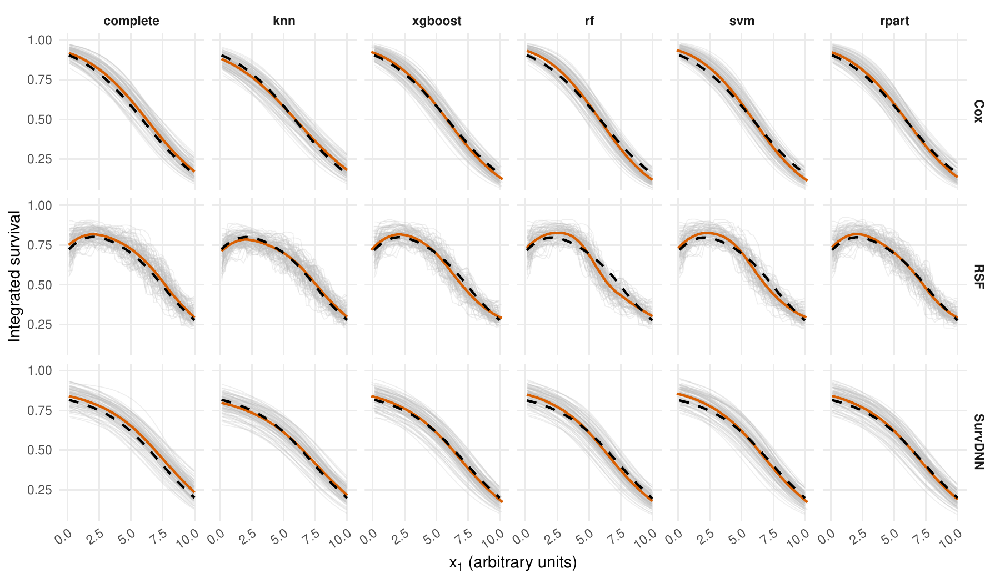

**Figure 5.** Brier score over follow-up time, complete-data versus imputed-data model (MI).

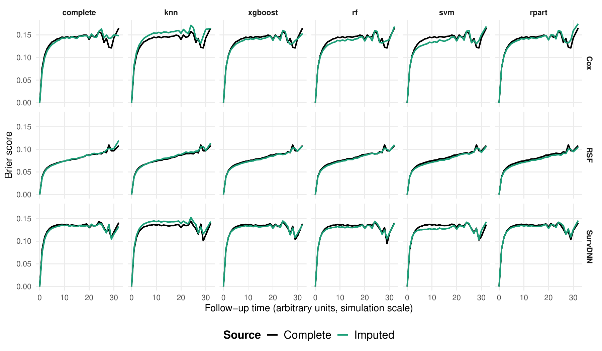

**Figure 6.** Calibration (predicted versus Kaplan-Meier observed survival), complete-data versus imputed-data model (MI).

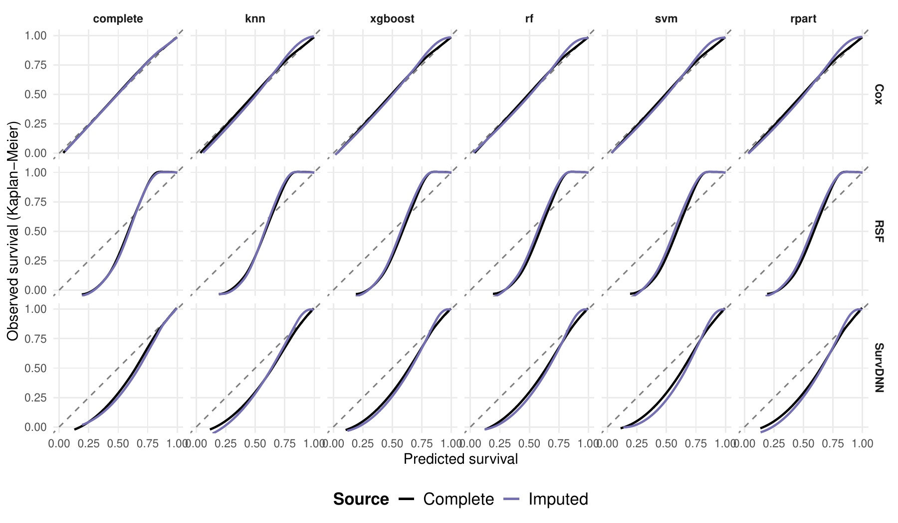

## Real-data application

The same learner, imputer and metric pipeline applied to four survival cohorts, each with three clinically relevant covariates jointly amputated at about 40% MAR. One amputation draw per cohort: an illustration of the diagnostic outside the controlled simulation, not a replicated comparison.

| Cohort | n | Jointly amputated covariates |
|---|:---:|---|

| Heart failure | 299 | ejection fraction, serum creatinine, serum sodium |
| Breast cancer | 672 | tumor size, positive lymph nodes, progesterone receptor |
| Colon cancer | 888 | age, positive lymph nodes, tumor differentiation |
| Primary biliary cirrhosis (PBC) | 276 | bilirubin, albumin, copper |

### Poster figure

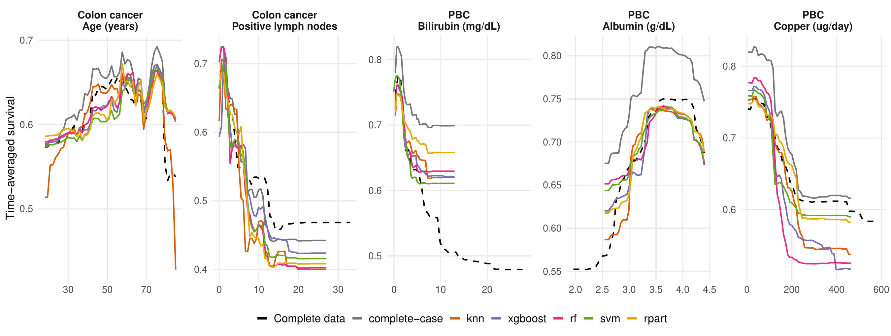

Partial dependence of time-averaged survival for colon cancer (left two panels) and PBC (right three panels). RSF learner, MI (M = 3), computed on the single amputated version of each cohort. Black dashed: complete-data reference; closer is better.

### Per-cohort results (RSF learner)

Best value per column in bold. Single imputation results are in the collapsible sections.

#### Heart failure

Amputed: ejection fraction, serum creatinine, serum sodium.

**Multiple imputation**

| Method | BriernRMSE | CalibnRMSE | PDPnRMSE | SHAPL1 | SHAPrank | VarImpL1 | VarImprank |
|---|:---:|:---:|:---:|:---:|:---:|:---:|:---:|
| complete-case | 0.214 | 0.090 | **0.262** | 0.458 | 0.164 | **0.162** | **0.005** |
| knn | 0.183 | 0.061 | 0.501 | 0.236 | 0.109 | 0.332 | 0.100 |
| xgboost | **0.168** | **0.059** | 0.395 | 0.204 | 0.095 | 0.167 | 0.045 |
| rf | 0.289 | 0.108 | 0.472 | 0.378 | 0.168 | 0.321 | 0.064 |
| svm | 0.253 | 0.096 | 0.494 | 0.313 | 0.109 | 0.305 | 0.105 |
| rpart | 0.375 | 0.202 | 0.370 | **0.200** | **0.073** | 0.233 | 0.050 |

Single imputation

| Method | BriernRMSE | CalibnRMSE | PDPnRMSE | SHAPL1 | SHAPrank | VarImpL1 | VarImprank |
|---|:---:|:---:|:---:|:---:|:---:|:---:|:---:|
| complete-case | 0.214 | 0.090 | **0.262** | 0.458 | **0.164** | 0.162 | **0.005** |
| knn | 0.230 | 0.081 | 0.579 | **0.247** | 0.190 | 0.312 | 0.100 |
| xgboost | **0.199** | **0.065** | 0.388 | 0.335 | 0.268 | **0.142** | 0.055 |
| rf | 0.281 | 0.091 | 0.438 | 0.481 | 0.400 | 0.317 | 0.068 |
| svm | 0.320 | 0.119 | 0.469 | 0.418 | 0.341 | 0.328 | 0.086 |
| rpart | 0.580 | 0.323 | 0.664 | 0.574 | 0.186 | 0.390 | 0.027 |

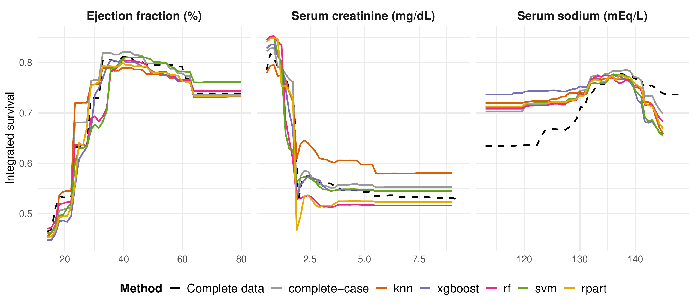

#### Breast cancer

Amputed: tumor size, positive lymph nodes, progesterone receptor.

**Multiple imputation**

| Method | BriernRMSE | CalibnRMSE | PDPnRMSE | SHAPL1 | SHAPrank | VarImpL1 | VarImprank |
|---|:---:|:---:|:---:|:---:|:---:|:---:|:---:|
| complete-case | 0.137 | **0.149** | 0.658 | 0.668 | 0.405 | **0.051** | **0.000** |
| knn | **0.031** | 0.178 | **0.317** | 0.190 | **0.083** | 0.133 | 0.024 |
| xgboost | 0.165 | 0.154 | 0.644 | 0.228 | 0.202 | 0.181 | 0.071 |
| rf | 0.374 | 0.242 | 0.525 | 0.201 | 0.095 | 0.140 | 0.048 |
| svm | 0.355 | 0.196 | 0.460 | **0.165** | 0.095 | 0.100 | 0.036 |
| rpart | 0.424 | 0.187 | 0.448 | 0.179 | 0.190 | 0.154 | 0.012 |

Single imputation

| Method | BriernRMSE | CalibnRMSE | PDPnRMSE | SHAPL1 | SHAPrank | VarImpL1 | VarImprank |
|---|:---:|:---:|:---:|:---:|:---:|:---:|:---:|
| complete-case | 0.137 | 0.149 | 0.658 | 0.668 | 0.405 | **0.051** | **0.000** |
| knn | **0.060** | 0.152 | 0.684 | **0.178** | **0.226** | 0.144 | 0.024 |
| xgboost | 0.185 | **0.116** | 0.820 | 0.415 | 0.500 | 0.148 | 0.036 |
| rf | 0.370 | 0.263 | 0.495 | 0.363 | 0.381 | 0.139 | 0.048 |
| svm | 0.355 | 0.240 | **0.354** | 0.513 | 0.440 | 0.093 | 0.012 |
| rpart | 0.488 | 0.304 | 0.402 | 0.464 | 0.464 | 0.244 | 0.024 |

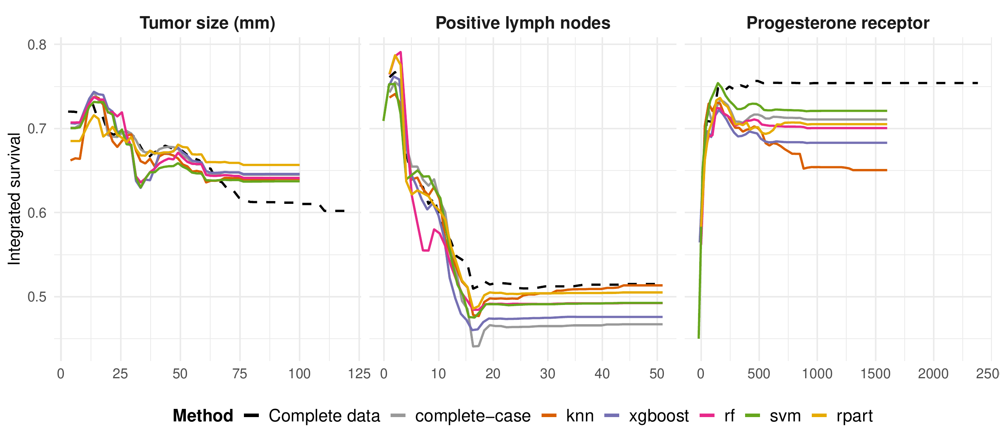

#### Colon cancer

Amputed: age, positive lymph nodes, tumor differentiation.

**Multiple imputation**

| Method | BriernRMSE | CalibnRMSE | PDPnRMSE | SHAPL1 | SHAPrank | VarImpL1 | VarImprank |
|---|:---:|:---:|:---:|:---:|:---:|:---:|:---:|
| complete-case | 0.141 | 0.261 | 0.933 | 0.516 | 0.364 | 0.100 | 0.050 |
| knn | **0.140** | **0.195** | **0.388** | **0.299** | 0.132 | 0.103 | 0.082 |
| xgboost | 0.436 | 0.326 | 0.650 | 0.340 | **0.102** | 0.128 | 0.091 |
| rf | 0.550 | 0.346 | 0.723 | 0.579 | 0.146 | 0.174 | 0.095 |
| svm | 0.588 | 0.281 | 0.798 | 0.455 | 0.158 | 0.144 | 0.036 |
| rpart | 0.534 | 0.283 | 0.545 | 0.452 | 0.138 | **0.093** | **0.036** |

Single imputation

| Method | BriernRMSE | CalibnRMSE | PDPnRMSE | SHAPL1 | SHAPrank | VarImpL1 | VarImprank |
|---|:---:|:---:|:---:|:---:|:---:|:---:|:---:|
| complete-case | **0.141** | 0.261 | 0.933 | 0.516 | 0.364 | 0.100 | 0.050 |
| knn | 0.160 | **0.189** | **0.590** | **0.435** | 0.307 | **0.098** | 0.082 |
| xgboost | 0.451 | 0.320 | 0.883 | 0.667 | 0.545 | 0.149 | 0.100 |
| rf | 0.516 | 0.275 | 0.811 | 0.704 | 0.452 | 0.171 | 0.105 |
| svm | 0.588 | 0.291 | 1.082 | 0.526 | 0.311 | 0.145 | 0.050 |
| rpart | 0.426 | 0.257 | 0.850 | 0.486 | **0.297** | 0.101 | **0.036** |

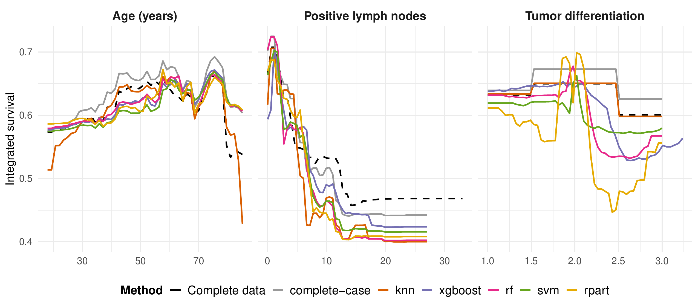

#### Primary biliary cirrhosis (PBC)

Amputed: bilirubin, albumin, copper.

**Multiple imputation**

| Method | BriernRMSE | CalibnRMSE | PDPnRMSE | SHAPL1 | SHAPrank | VarImpL1 | VarImprank |
|---|:---:|:---:|:---:|:---:|:---:|:---:|:---:|
| complete-case | 0.302 | 0.727 | 0.693 | 0.599 | 0.405 | 0.175 | 0.163 |
| knn | **0.083** | 0.156 | 0.860 | 0.564 | 0.465 | 0.245 | 0.054 |
| xgboost | 0.191 | 0.165 | 0.381 | 0.505 | **0.344** | 0.125 | 0.051 |
| rf | 0.188 | 0.165 | **0.361** | 0.598 | 0.530 | 0.141 | 0.039 |
| svm | 0.100 | **0.087** | 0.495 | 0.495 | 0.368 | **0.080** | **0.021** |
| rpart | 0.152 | 0.103 | 0.575 | **0.492** | 0.387 | 0.218 | 0.064 |

Single imputation

| Method | BriernRMSE | CalibnRMSE | PDPnRMSE | SHAPL1 | SHAPrank | VarImpL1 | VarImprank |
|---|:---:|:---:|:---:|:---:|:---:|:---:|:---:|
| complete-case | 0.302 | 0.727 | 0.693 | 0.599 | 0.405 | 0.175 | 0.163 |
| knn | **0.074** | 0.101 | 0.605 | 0.605 | 0.431 | 0.114 | 0.058 |
| xgboost | 0.200 | 0.236 | 0.378 | 0.379 | 0.417 | 0.123 | 0.049 |
| rf | 0.173 | 0.101 | **0.361** | 0.446 | 0.352 | 0.150 | 0.044 |
| svm | 0.089 | **0.037** | 0.500 | **0.331** | **0.276** | **0.105** | **0.029** |
| rpart | 0.215 | 0.230 | 0.878 | 0.764 | 0.358 | 0.140 | 0.053 |

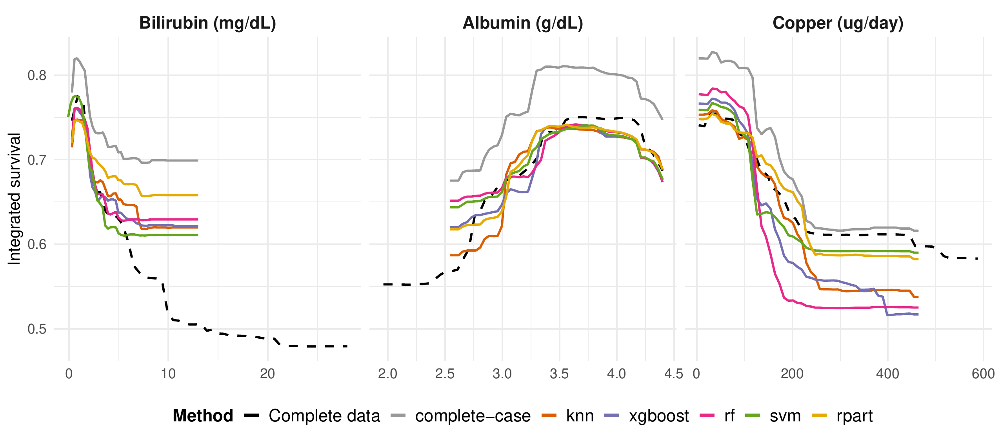

## Files

| Folder | Contents |
|---|---|
| [`figures/`](figures) | All figures, as vector PDF (publication quality) and PNG (for this page) |
| [`tables/`](tables) | LaTeX sources of every table: `tables_v4.tex` (simulation), `table_inference_v4.tex` (tests), `table_multi_v4.tex` (cohorts, MI), `table_multi_v4_SI.tex` (cohorts, SI) |
| [`summaries/`](summaries) | Simulation summary statistics (mean, SD, MCSE per cell) and Friedman test p-values, as CSV |

## Code and citation

The analysis code (simulation, real-data pipeline, table and figure scripts) will be made public when the paper is published. A citation will be added here at that point. Until then, please cite the ISCB-GMDS 2026 poster:

> El Badisy I, Giorgi R. Does your imputer preserve your model's explanation? Assessing imputation for survival ML via interpretability distortion. Poster, ISCB-GMDS 2026, Freiburg, Germany.
